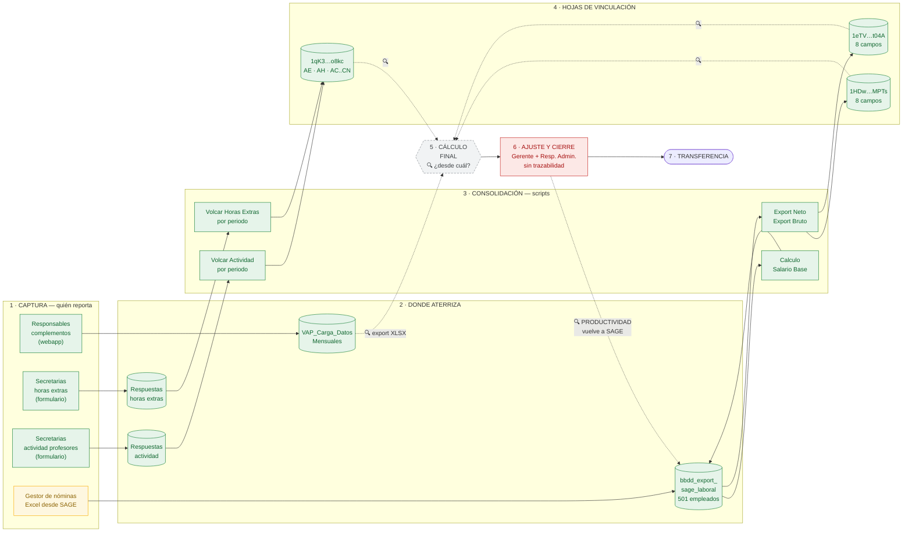
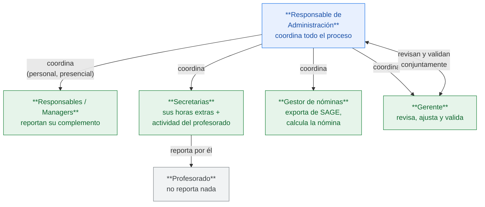
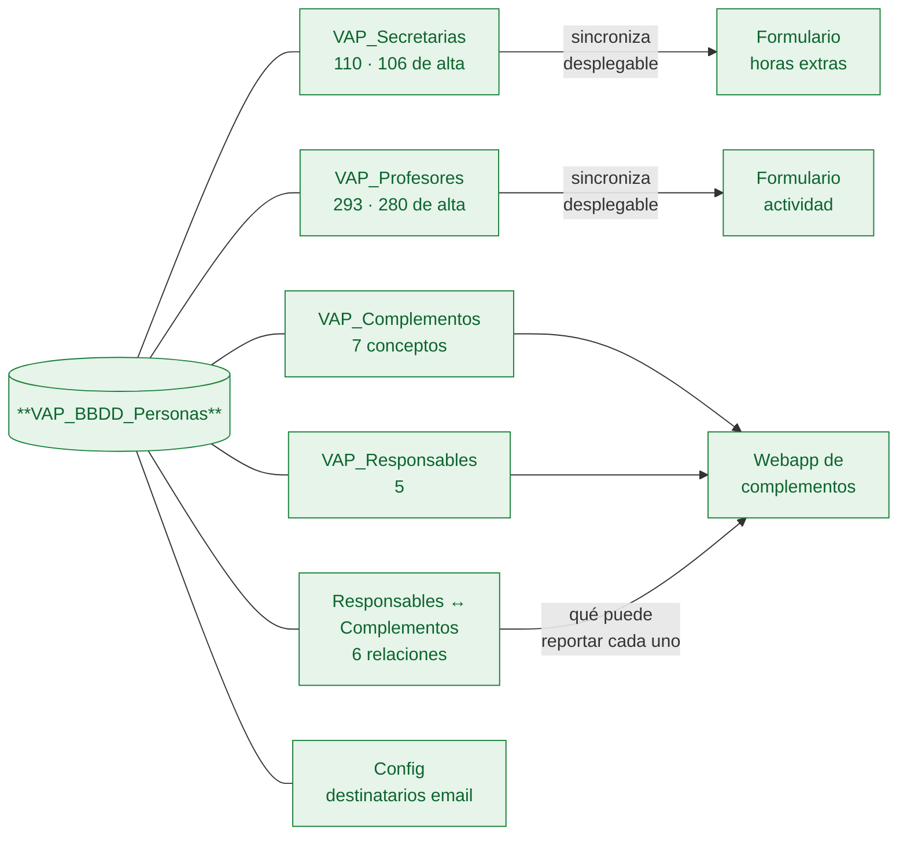
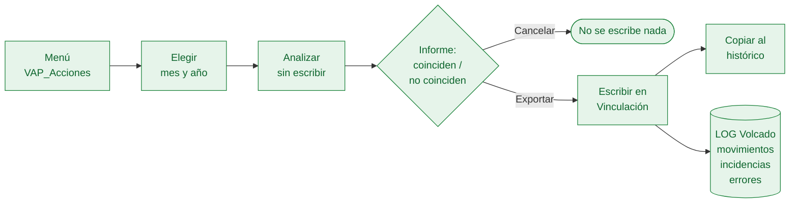
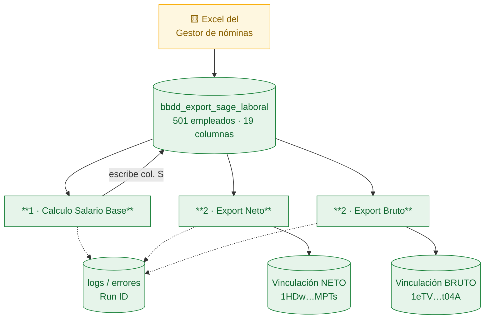
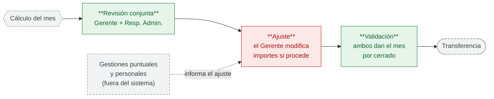
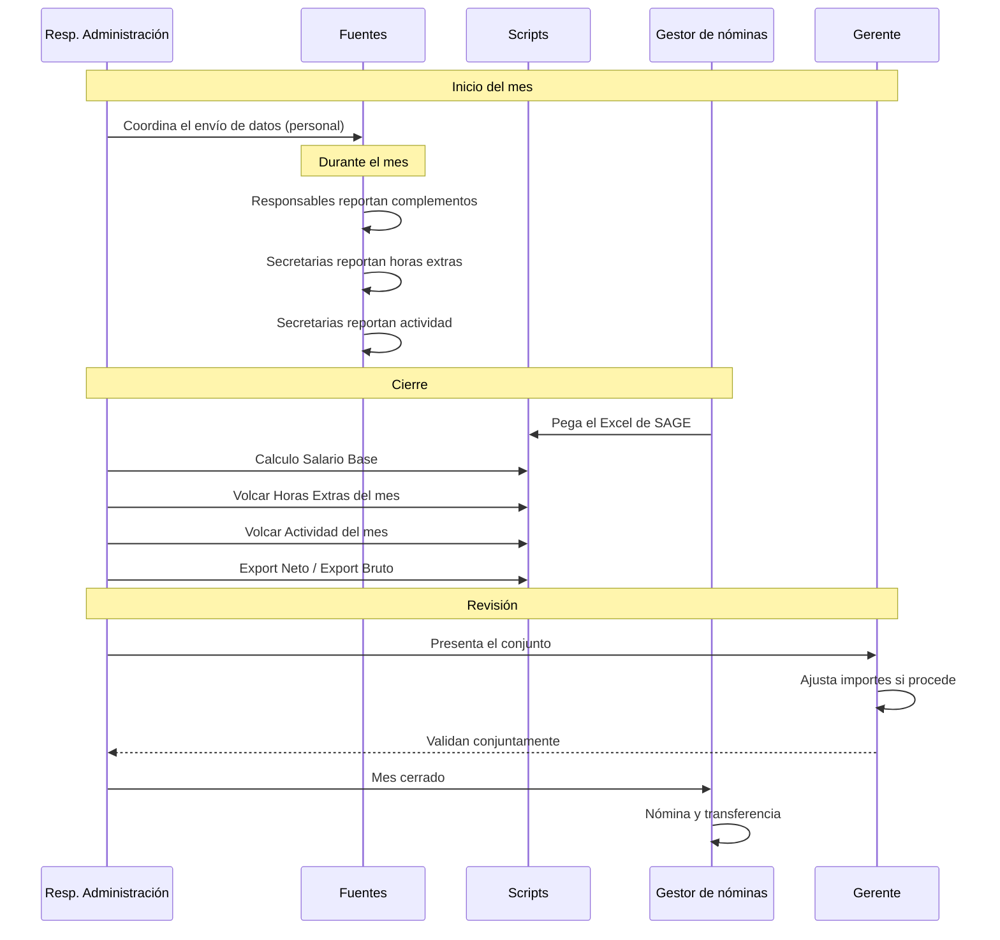

# FLUJO — Del dato a la nómina

Recorrido completo del proceso mensual: **qué dato nace dónde, por qué manos pasa, en qué hoja
aterriza y qué transformación sufre en cada salto**, desde el momento cero hasta el cálculo final.

| | |
|---|---|
| **Versión** | 0.1 — BORRADOR, pendiente de revisión |
| **Fecha** | 17 agosto 2026 |
| **Estado** | Reconstruido a partir del código y de los Sheets accesibles |
| **Responde a** | [Deuda técnica · DT-16](dudas/deuda-tecnica.md#dt-16--falta-el-mapa-del-flujo-de-datos-y-usuarios) |

> ⚠️ **Este documento tiene zonas oscuras y están señaladas.** Lo verificado procede de leer el
> código y los Spreadsheets reales. Lo que aparece con borde discontinuo o marcado como 🔍 es
> **inferencia o desconocido**, y necesita confirmación. Ver [§9](#9-zonas-oscuras).

---

## Leyenda

| Símbolo | Significado |
|---------|-------------|
| 🟩 Verde | Verificado contra código o datos reales |
| 🟨 Amarillo | Paso **manual**: lo hace una persona, no un script |
| ⬜ Discontinuo | 🔍 No confirmado: inferencia o desconocido |
| 🟥 Rojo | Punto sin control ni trazabilidad |

---

## 1. Vista general



**Los cuatro bloques en una frase:** cuatro fuentes distintas **capturan** datos → aterrizan en
cuatro Sheets → **cuatro scripts** los consolidan y los vuelcan → confluyen (o deberían) en las hojas
de Vinculación, de donde sale el **cálculo final**.

---

## 2. Quién interviene



| Rol | Qué hace | Nº |
|-----|----------|----|
| **Responsable de Administración** | Coordina el cierre completo, en buena parte de forma personal. Opera los scripts | 1 |
| **Responsables / Managers** | Reportan el complemento del que son responsables | 5 de alta · 4 activos |
| **Secretarias** | Reportan sus horas extras y parte de la actividad del profesorado | 110 |
| **Gestor de nóminas** | Exporta de SAGE, emite el documento inicial y produce el cálculo final | 1 |
| **Gerente** | Revisa el conjunto, modifica importes si procede y valida el cierre | 1 |
| **Profesorado** | **No interviene**: su retribución la determinan datos que reportan otros | 293 |

---

## 3. Momento cero — el maestro de personal

Todo arranca en **`VAP_BBDD_Personas`**, que decide **quién existe** para el sistema.



Dos scripts gemelos mantienen los desplegables al día: leen las personas con `Alta = TRUE` y
reescriben las opciones del formulario. Al enviarse una respuesta, escriben además el `ID_Secre` o
el `ID_Profesor` en la hoja de respuestas.

> **Si alguien no está de alta aquí, no existe para el sistema**: no aparece en los desplegables ni
> se le puede reportar nada.

---

## 4. Captura — las cuatro vías de entrada

```mermaid
flowchart TB
    subgraph V1["Vía 1 · Complementos de secretarias"]
        R1["Responsable"] -->|"webapp, reporte masivo"| D1[("Data<br/>1.724 registros")]
    end
    subgraph V2["Vía 2 · Horas extras"]
        R2["Secretaria"] -->|"formulario"| D2[("Respuestas<br/>de formulario")]
    end
    subgraph V3["Vía 3 · Actividad del profesorado"]
        R3["Secretaria"] -->|"formulario, 64 campos"| D3[("Respuestas<br/>de formulario 1")]
    end
    subgraph V4["Vía 4 · Datos de nómina"]
        R4["Gestor de nóminas"] -->|"🟨 pega un Excel<br/>exportado de SAGE"| D4[("bbdd_export_<br/>sage_laboral")]
    end

    classDef ok fill:#e6f4ea,stroke:#188038,color:#0d652d
    classDef manual fill:#fef7e0,stroke:#f9ab00,color:#8a6100
    class R1,R2,R3,D1,D2,D3 ok
    class R4,D4 manual
```



| Vía | Quién | Cómo | Qué captura |
|-----|-------|------|-------------|
| **1 · Complementos** | Responsable | Webapp propia, reporte masivo | Importe por secretaria y concepto |
| **2 · Horas extras** | Secretaria | Formulario Google | Nº de horas y € de otros extras |
| **3 · Actividad** | Secretaria | Formulario Google | 64 conceptos de actividad docente |
| **4 · Nómina** | Gestor de nóminas | 🟨 **Copiar y pegar un Excel** | Bruto, seguros, SS, IRPF, líquido… |

La **vía 4 es el único punto de entrada sin automatizar**: alguien exporta de SAGE y pega el
resultado. Todo lo que viene después depende de que ese pegado sea correcto y esté al día.

---

## 5. Consolidación — los volcados

Los tres volcados de actividad siguen **el mismo patrón** desde agosto de 2026:



**Qué escribe cada uno:**

| Volcado | Origen | Cruce | Destino | Regla |
|---------|--------|-------|---------|-------|
| **Horas extras** | Respuestas HH.EE. | Nombre → col. `C` | `AE`, `AH` | Gana el envío de marca temporal más reciente |
| **Actividad** | Respuestas actividad | Nombre → col. `C` | `AC..CN` | **Acumula campo a campo**: gana la última celda con dato |
| **Nóminas** | `bbdd_export_sage_laboral` | Empresa + Nº empleado → `E` + `F` | `G,H,I,L,P,Q,R,T` | Sobrescribe |

> **Por qué la actividad acumula y las horas extras no.** Varias secretarias reportan **partes
> distintas** de la actividad del mismo profesor: en el histórico hay **122 pares (profesor, mes)
> con más de un reporte**. Quedarse con el último envío borraría el trabajo de las demás.

---

## 6. Salario base y volcado de nóminas



**El cálculo del salario base:**

```
salario_base_bruto  =  TOTAL_BRUTO
                     + |SEGURO_MEDICO|
                     + |COBE_Transporte|
                     + |COBE_Alimentacion|
```

Se escribe en la columna **S** del origen. ✅ *Verificado: 498 de 501 filas cuadran exactamente con
la fórmula; las 3 restantes no tienen datos en esas columnas.*

**El orden importa:** hay que ejecutar *Calculo Salario Base* **antes** de los export, porque la
columna "Salario Base" del destino se alimenta de él.

> 🔍 El registro muestra **9 Export Neto, 7 Export Bruto y solo 2 Calculo Salario Base** entre mayo
> y julio. O el salario base rara vez cambia, o se han hecho exports con el valor de un mes anterior.

**Los 8 campos que viajan a Vinculación:**

| Origen (SAGE) | → Destino |
|---|---|
| `SEGURO_MEDICO` | G · ADESLAS |
| `COBE_Alimentacion` | H · COBEE COMIDA |
| `COBE_Transporte` | I · COBEE TRANSPORTE |
| `salario_base_bruto` | L · Salario Base |
| `SS_EMP` | P · SS Empresa |
| `SS_TRABAH` | Q · SS trabajador |
| `IRPF` | R · IRPF |
| `Líquido_a_percibir` | T · Nomina NETO |

**No viajan:** `TOTAL_BRUTO`, `PRODUCTIVIDAD`, `ANTICIPO_NOM`, `EMBARGO`, `COMIDA_EXENTO`,
`TRANSPORTE_EXENTO` ni `Porcentaje_de_jornada`.

---

## 7. El retorno de `PRODUCTIVIDAD`

Aquí el flujo **deja de ser lineal**: lo que sale de todo el proceso de complementos vuelve al
origen.


**Lo que sé:** la columna **J (`PRODUCTIVIDAD`)** de `bbdd_export_sage_laboral` es donde acaba todo
lo tratado en este sistema — complementos, horas extras y actividad docente. Se completa **al final**
del proceso.

**Lo que no sé** 🔍:

- `PRODUCTIVIDAD` **no se vuelca a Vinculación** (no está entre los 8 campos). Si se rellena al
  final, tiene que volver al sistema de nóminas **por otra vía**. ¿La introduce el Gestor de nóminas
  en SAGE a mano?
- Si cada mes se pega un Excel nuevo sobre `bbdd_export_sage_laboral`, ese pegado **borraría** la
  `PRODUCTIVIDAD` del mes anterior. ¿Se rellena siempre después de pegar?

---

## 8. Ajuste y cierre



El ajuste **no corrige errores de captura**: incorpora información que **nunca entró en el sistema
porque nace fuera de él** — gestiones puntuales, acuerdos y circunstancias personales.

> 🟥 **Este paso no deja rastro, y es una decisión deliberada**
> ([anti-objetivo en problem.md §8](problem.md#8-fuera-de-alcance-y-anti-objetivos)). Consecuencia:
> el importe final de un concepto **puede no coincidir** con el que reportó su fuente, y esa
> diferencia no es reconstruible después.

---

## 9. Zonas oscuras

Lo que este documento **no puede responder** todavía:

| # | Pregunta | Impacto | Dónde se sigue |
|---|----------|---------|----------------|
| 1 | **¿De qué libro sale la nómina final?** Hay tres destinos y no consta cuál alimenta el cálculo | 🔴 Alto | [DUDA-0001](dudas/0001-tres-libros-destino-de-los-volcados.md) |
| 2 | **¿Hay copia manual entre libros?** Si la actividad va a uno y la nómina se calcula desde otro, alguien mueve esos datos | 🔴 Alto | [DUDA-0001](dudas/0001-tres-libros-destino-de-los-volcados.md) |
| 3 | **¿Cómo vuelve `PRODUCTIVIDAD` a SAGE?** No se vuelca a Vinculación, así que debe entrar por otra vía | 🔴 Alto | §7 |
| 4 | **¿Por qué neto y bruto son dos libros**, si reciben los mismos 8 campos con los mismos valores? | 🟡 Medio | §6 |
| 5 | **¿`ANTICIPO_NOM` y `EMBARGO` deben restarse del salario base?** | 🟡 Medio | Pendiente de consultar |
| 6 | **¿`Porcentaje_de_jornada` se aplica en algún punto?** 153 de 501 están a jornada parcial y no se usa en ningún cálculo | 🟡 Medio | §6 |
| 7 | **¿En qué momento del mes ocurre cada paso?** No hay calendario del cierre | 🟡 Medio | §10 |
| 8 | **¿Cómo se genera la transferencia** y desde qué dato? | 🟡 Medio | Fase 3.D del [ROADMAP](ROADMAP.md) |

---

## 10. Calendario del mes

🔍 **Sin confirmar.** Esta secuencia es una **inferencia** a partir del orden lógico de dependencias
y de las fechas de los registros, no del proceso real. Es de lo primero que conviene corregir.



**Lo que falta por concretar:** fechas límite de cada paso, quién avisa a quién de que puede
empezar, y qué ocurre si una fuente no reporta a tiempo.

---

## 11. Inventario de recursos

| Recurso | ID / Ubicación | Qué contiene |
|---------|----------------|--------------|
| `VAP_BBDD_Personas` | `1HQMx…hjmHk` | Maestro de personal, conceptos y responsables |
| `VAP_Carga_Datos_Mensuales` | `1mYXU…Vu5NY` | `Data` (1.724), `Logs` (65), `Errores` (0) |
| Respuestas horas extras | `1fW2b…X5m0w` | `Respuestas de formulario`, `Anteriores` |
| Respuestas actividad | `1qRUy…XVhMk` | `Respuestas de formulario 1`, `Hoja 1` (histórico, 1.730) |
| `VAP_Export_Sage` | `19edO…u0454` | `bbdd_export_sage_laboral` (501), `vinculo_columnas`, `logs`, `errores` |
| Vinculación (actividad) | `1qK3J…iYo8kc` | Recibe `AE`, `AH`, `AC..CN` |
| Vinculación **NETO** | `1HDwg…VGMPTs` | Recibe los 8 campos de nómina |
| Vinculación **BRUTO** | `1eTVP…jFt04A` | Recibe los 8 campos de nómina |

**Premisa del proceso:** cada mes se parte de una **hoja de Vinculación limpia**. De ahí que los
volcados puedan escribir solo los campos con valor sin mezclar meses — y que ambos comprueben, antes
de escribir, que el destino está efectivamente vacío.

---

## Cómo mantener este documento

Es el mapa de referencia del sistema: **si cambia el proceso, se actualiza aquí antes que en
ningún otro sitio**. Los diagramas están en Mermaid, que GitHub renderiza y que se versiona como
texto plano — se pueden revisar en un diff, a diferencia de una imagen.

Cuando se resuelva una zona oscura de [§9](#9-zonas-oscuras), conviene sustituir el borde
discontinuo por el trazo continuo y anotar de dónde salió la respuesta.
