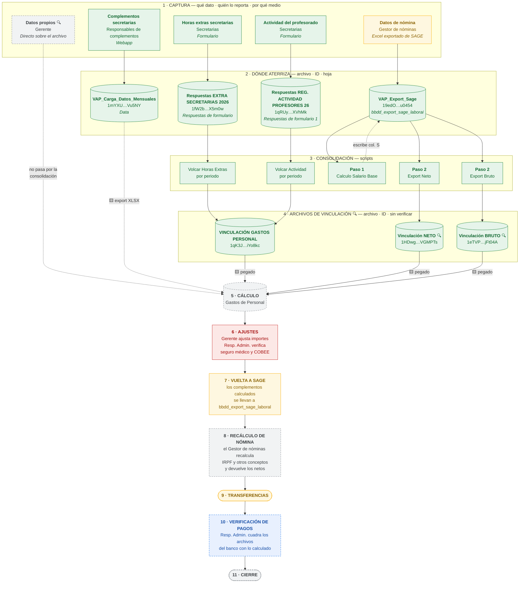
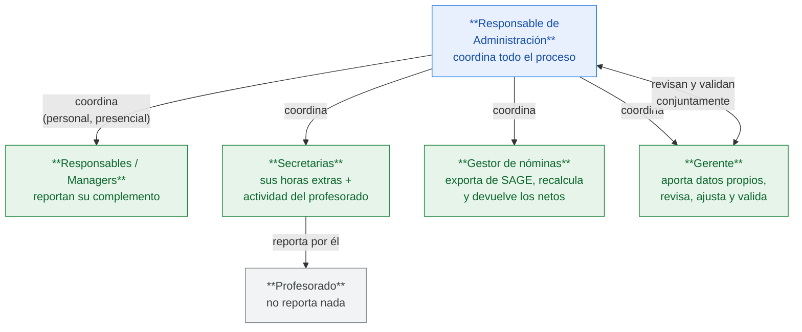
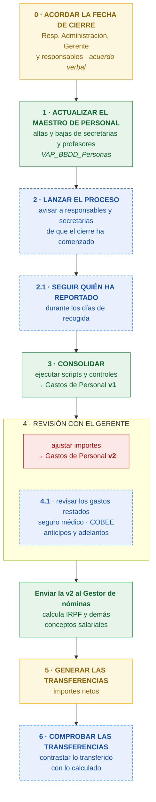
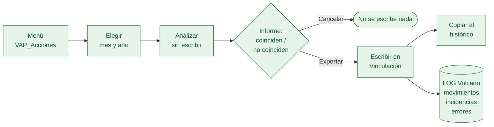
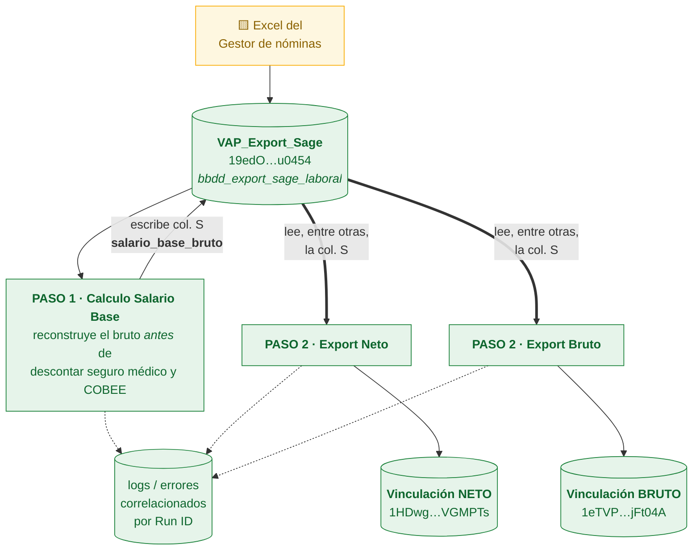
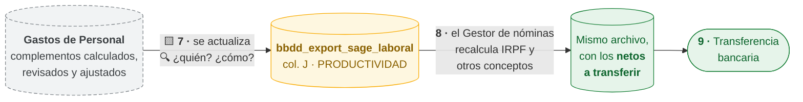
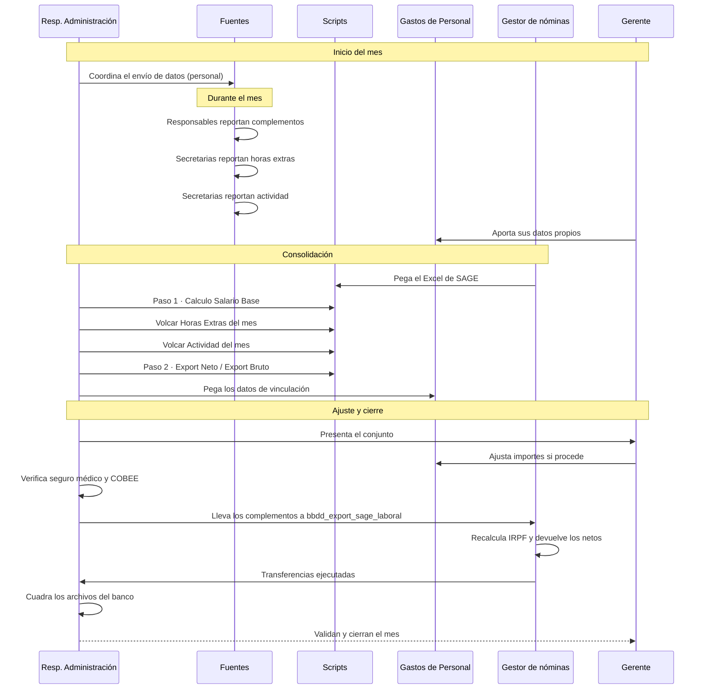

# FLUJO — Del dato a la nómina

Recorrido completo del proceso mensual: **qué dato nace dónde, por qué manos pasa, en qué hoja
aterriza y qué transformación sufre en cada salto**, desde el momento cero hasta la transferencia y
el cierre.

| | |
|---|---|
| **Versión** | 0.2 — BORRADOR, en revisión punto por punto |
| **Fecha** | 18 agosto 2026 |
| **Estado** | Reconstruido a partir del código y de los Sheets accesibles, revisado con el responsable del sistema |
| **Responde a** | [Deuda técnica · DT-16](../dudas/deuda-tecnica.md#dt-16--falta-el-mapa-del-flujo-de-datos-y-usuarios) |

> 🛑 **Aviso — este documento describe la versión que está EN PRODUCCIÓN, no el repositorio.**
> El código del repositorio ya **no tiene** la acción *Calculo Salario Base* (ADR-0015), pero el Apps
> Script desplegado **sigue mostrándola** hasta que se despliegue. Mientras tanto, **el paso 3 de
> abajo sigue siendo válido en el sistema real** y no debe saltarse. Esta nota se retira, y el
> documento se corrige, cuando se despliegue (OB-30 y OB-39 en [proximos_pasos.md](../proximos_pasos.md)).

> ⚠️ **Este documento tiene zonas oscuras y están señaladas.** Lo verificado procede de leer el
> código y los Spreadsheets reales. Lo que aparece con borde discontinuo o marcado como 🔍 es
> **inferencia o desconocido**, y necesita confirmación. Las que tienen ficha propia viven en
> [`docs_work/dudas/`](../dudas/README_dudas.md).

---

## Leyenda

| Símbolo | Significado |
|---------|-------------|
| 🟩 Verde | Verificado contra código o datos reales |
| 🟨 Amarillo | Paso **manual**: lo hace una persona, no un script |
| 🟦 Azul | Proceso **identificado pero aún no construido**: se sabe que hace falta, falta definirlo técnicamente |
| ⬜ Discontinuo | 🔍 No confirmado: inferencia o desconocido |
| 🟥 Rojo | Punto sin control ni trazabilidad |

---

## 1. Vista general

**El recorrido en una frase:** cinco fuentes **capturan** datos → aterrizan en cuatro archivos →
cinco **scripts** los consolidan y los vuelcan a tres archivos de **vinculación** → de ahí se
**pegan a mano** en *Gastos de Personal*, que es donde se calcula → y a partir de ese punto el
proceso vuelve a ser manual hasta el cierre.

Tres cosas que este diagrama deja ver y conviene no pasar por alto:

- **El dato del Gerente no pasa por la cadena de consolidación.** Entra directamente en el archivo
  de cálculo, saltándose captura estructurada, scripts y vinculación. Es la única fuente que no deja
  rastro en ninguna hoja de respuestas.
- **Entre la vinculación y el cálculo hay un pegado manual.** Los scripts escriben en tres archivos
  distintos, y alguien los lleva a *Gastos de Personal*. Ese salto no está automatizado ni auditado.
- **La segunda mitad del recorrido no tiene automatización.** Del paso 5 al 11 —cálculo, ajustes,
  vuelta a SAGE, recálculo, transferencia, verificación y cierre— todo es manual o **está por
  construir**. Los pasos 6 y 10 corresponden a las fases 3.B, 3.C y 3.D del
  [requisitos](../../docs_discovery/requisitos_funcionales.md).

> 🔍 **El bloque 4 está sin verificar.** Los tres archivos de vinculación son los que aparecen
> **en el código**, identificados solo por su ID. No está confirmado que sean los que realmente se
> usan, ni que sean solo tres: es posible que existan **varios Excel distintos** en juego. Hay que
> **revisar el bloque entero con la Responsable de Administración** antes de dar el mapa por bueno.
> Ver [DUDA-0001](../dudas/0001-RESUELTA-tres-libros-destino-de-los-volcados.md).

---

## 2. Quién interviene

| Rol | Qué hace |
|-----|----------|
| **Responsable de Administración** | Coordina el cierre completo, en buena parte de forma personal. Opera los scripts. **Verifica** el seguro médico y COBEE en el ajuste, y **cuadra las transferencias** con lo calculado |
| **Responsables / Managers** | Reportan el complemento del que son responsables |
| **Secretarias** | Reportan sus horas extras y parte de la actividad del profesorado |
| **Gestor de nóminas** | Exporta de SAGE, emite el documento inicial y, tras el ajuste, **recalcula IRPF y el resto de conceptos** y devuelve el archivo con los **netos a transferir** |
| **Gerente** | **Aporta datos de origen propio** directamente en *Gastos de Personal*, revisa el conjunto, modifica importes si procede y valida el cierre |
| **Profesorado** | **No interviene**: su retribución la determinan datos que reportan otros |

> El Gerente es **a la vez fuente de datos y validador** del resultado. Es el único rol que ocupa
> los dos extremos del recorrido.

> **No todos los responsables dados de alta son responsables reales.** En `VAP_Responsables` hay uno
> más de los que reportan: es la **cuenta de quien mantiene el sistema**, que entra a hacer pruebas
> de funcionamiento. No es un responsable de negocio y no reporta complementos reales.
>
> Esto explica la diferencia que quedó sin cuadrar en [DT-10](../dudas/deuda-tecnica.md) —*los dados de
> alta no coinciden con los que tienen envíos*— y hay que tenerlo presente al medir cobertura: **la
> cuenta de pruebas no cuenta en el denominador**.

---

## 3. El proceso mensual, paso a paso

Mientras el resto del documento describe **por dónde va el dato**, este apartado describe **en qué
orden hay que trabajar**. Es la secuencia del cierre, del momento cero a la comprobación del pago,
con los archivos y scripts que aplican en cada paso.

---

### Paso 0 · Acordar la fecha de cierre — 🟨 manual

La **Responsable de Administración** acuerda **de forma verbal** con el **Gerente** y con buena
parte del resto de responsables el **día de cierre** para el cálculo de las nóminas.

> Es el punto de arranque de todo el mes y **no queda registrado en ninguna parte**. Nadie que no
> estuviera en esa conversación sabe cuál es la fecha, y no hay forma de comprobar después si se
> cumplió.

### Paso 1 · Actualizar el maestro de personal — 🟩 hecho

Fijada la fecha, lo primero es **revisar y actualizar `VAP_BBDD_Personas`**: las **altas y bajas**
de secretarias y profesores.

| | |
|---|---|
| **Archivo** | `VAP_BBDD_Personas` — pestañas `VAP_Secretarias`, `VAP_Profesores` |
| **Scripts** | `VAP_Script_Actualizacion_Automatica_Secretarias.gs` · `VAP_Script_Actualizacion_Automatica_Profesores.gs` |
| **Qué hacen** | Leen las personas con `Alta = TRUE` y reescriben los desplegables de los dos formularios. Al recibirse una respuesta, escriben además el `ID_Secre` o el `ID_Profesor` en la hoja de respuestas |

> **Por qué va primero: si alguien no está de alta aquí, no existe para el sistema.** No aparece en
> los desplegables y no se le puede reportar nada. Hacerlo después de que la gente empiece a
> reportar significa que a los recién dados de alta ya nadie les reporta ese mes.
>
> Con una excepción: los datos que el **Gerente** introduce directamente en *Gastos de Personal* no
> pasan por este control.

**Dar de alta a un profesor** (desde el 25 sep 2026, `VAP_Profesores` protege tres columnas):

- **`Empresa`** se **elige del desplegable**. No se puede escribir a mano.
- **`ID_Profesor` no se escribe**: se calcula solo como `Empresa_Id_Sage`. Si sale vacío, falta la
  empresa o el `Id_Sage`, y la persona **no aparecerá en el formulario** hasta completarlos.
- **`Alta`** es una **casilla**: marcada, está de alta; desmarcada, de baja.
- Para pegar datos, **Ctrl+Mayús+V** (solo valores).
- **Si un profesor cambia de empresa, no se edita su fila:** se le da de baja y se crea una nueva.

El detalle está en [SSD §6.1.0](../../docs_solutions/docs_design/SSD.md#610-reglas-de-entrada-de-vap_profesores).
`VAP_Secretarias` todavía no tiene estas reglas.

### Paso 2 · Lanzar el proceso y avisar a las fuentes — 🟦 por construir

La Responsable de Administración **activa el lanzamiento del cierre**, y eso hace que a
**responsables y secretarias** les llegue un **email** avisando de que el proceso mensual ha
comenzado y de que deben reportar sus datos.

**Hoy no existe:** el aviso es la coordinación personal y presencial descrita en [§2](#2-quién-interviene).
El sistema ya envía correos en otros momentos (confirmación de remesa al responsable, aviso al
gestor), así que el mecanismo está probado; lo que falta es el disparo de inicio.

### Paso 2.1 · Seguir quién ha reportado — 🟦 por construir

Durante los días siguientes, la Responsable de Administración debe poder ver **de un vistazo quién
ha enviado y quién no**, sin perseguir a nadie a ciegas.

| Colectivo | ¿Es factible? | Cómo |
|-----------|---------------|------|
| **Responsables de complementos** | **Sí** | La hoja `Logs` de `VAP_Carga_Datos_Mensuales` registra cada remesa con su responsable, mes y año. Se sabe quién ha enviado, cuándo y cuántos registros. El denominador es conocido: **los responsables reales** |
| **Secretarias** (horas extras) | **Difícil** | Se sabe quién ha enviado, pero **no quién debía enviar**: puede que ese mes no tuviera horas extras |
| **Profesores** (actividad) | **Difícil** | Igual, y además agravado: quien reporta es la secretaria, no el profesor |

> **El problema de fondo:** en complementos, *no haber enviado* es una anomalía. En horas extras y
> actividad, *no haber enviado* y *no tener nada que reportar* son indistinguibles, y el sistema
> solo registra lo que llega — nunca lo que no llega.
>
> 💡 **Una salida posible, si se decide abordarlo:** que reportar "**este mes no tengo nada**" sea
> un envío como cualquier otro. Convierte el silencio en un dato y hace medible la cobertura real,
> a costa de pedir una acción a quien no tiene nada que decir. Queda **abierto**: si resulta caro
> en fricción, es razonable dejarlo fuera y conformarse con el seguimiento de responsables.

### Paso 3 · Consolidar y generar la v1 de *Gastos de Personal* — 🟩 hecho / 🟨 manual

Con **todos los datos reportados** —responsables de complementos, secretarias y Gestor de nóminas—
se ejecutan los scripts y los controles, y se genera la **primera versión de *Gastos de Personal***.

### Paso 3.1 · La secuencia de ejecución

**El orden importa.** Esta es la lista para ir completando de arriba abajo:

| # | Qué | Quién | Dónde | Tipo |
|---|-----|-------|-------|------|
| 1 | Pegar el Excel exportado de SAGE | Gestor de nóminas | `VAP_Export_Sage` → `bbdd_export_sage_laboral` | 🟨 manual |
| 2 | Comprobar que las hojas de Vinculación están **limpias** | Resp. Administración | Archivos de vinculación | 🟨 manual |
| 3 | **Calculo Salario Base** | Resp. Administración | Menú `VAP_Acciones` en `VAP_Export_Sage` | 🟩 script |
| 4 | **Export Neto** | Resp. Administración | Menú `VAP_Acciones` en `VAP_Export_Sage` | 🟩 script |
| 5 | **Export Bruto** | Resp. Administración | Menú `VAP_Acciones` en `VAP_Export_Sage` | 🟩 script |
| 6 | **Volcar Horas Extras del mes** | Resp. Administración | Menú `VAP_Acciones` en la hoja de respuestas de horas extras | 🟩 script |
| 7 | **Volcar Actividad del mes** | Resp. Administración | Menú `VAP_Acciones` en la hoja de respuestas de actividad | 🟩 script |
| 8 | **Exportación mensual de complementos** | Resp. Administración | Webapp de complementos | 🟩 script |
| 9 | Pegar todo en *Gastos de Personal* → **v1** | Resp. Administración | *Gastos de Personal* | 🟨 manual |

**Las dos únicas dependencias reales de orden:**

- **El paso 3 va antes que el 4 y el 5.** *Calculo Salario Base* escribe la columna `S`, y los dos
  export la leen. Al revés, se vuelca el salario base del mes anterior ([§6](#6-salario-base-y-volcado-de-nóminas)).
- **El paso 2 va antes que cualquier volcado.** Todo el diseño asume una hoja de Vinculación limpia
  ([§9](#9-inventario-de-recursos)).

Los pasos 6, 7 y 8 son independientes entre sí y del bloque 3-4-5: pueden hacerse en cualquier orden.

> **Los tres volcados avisan antes de escribir.** Cada uno pide mes y año, muestra un informe de qué
> filas coinciden y cuáles no, y **solo escribe si se confirma**. Cancelar no deja rastro
> ([§5](#5-consolidación--los-volcados)).

### Paso 4 · Revisión con el Gerente y v2 — 🟥 sin trazabilidad

La Responsable de Administración y el **Gerente revisan juntos *Gastos de Personal***, se realizan
los **ajustes** que procedan y se genera la **v2**, que se envía al **Gestor de nóminas** para que
calcule el **IRPF y el resto de conceptos salariales**.

> **El ajuste no corrige errores de captura:** incorpora información que nunca entró en el sistema
> porque **nace fuera de él** — gestiones puntuales, acuerdos y circunstancias personales.
>
> 🟥 **No deja constancia de quién lo hizo, cuándo ni por qué, y es una decisión deliberada**
> ([anti-objetivo en problem.md §8](../../docs_discovery/problem.md#8-fuera-de-alcance-y-anti-objetivos)). Consecuencia:
> el importe final de un concepto **puede no coincidir** con el que reportó su fuente, y esa
> diferencia no es reconstruible después.

### Paso 4.1 · Revisar los gastos restados — 🟦 por construir

En la misma revisión hay que comprobar los importes que **se restan**: **seguro médico**, **COBEE**
(comida y transporte), **anticipos** y **adelantos**.

> **No es una comprobación menor:** seguro médico y COBEE entran en la fórmula del salario base
> ([§6.1](#61-el-cálculo-del-salario-base)), así que un error se propaga a todo lo que se calcula
> después.
>
> 🔍 De los cuatro conceptos, **solo seguro médico y COBEE viajan a Vinculación**. `ANTICIPO_NOM` y
> `EMBARGO` no entran en la fórmula ni se vuelcan, así que **no consta dónde se restan hoy**. Es
> parte de lo que esta revisión tiene que aclarar antes de poder construirse.

### Paso 5 · Generar las transferencias — 🟨 manual

Se ejecutan las transferencias de los **importes netos** que devuelve el Gestor de nóminas tras el
recálculo.

### Paso 6 · Comprobar las transferencias — 🟦 por construir

Con los **archivos del banco**, la Responsable de Administración contrasta que **lo efectivamente
transferido corresponde con lo calculado**.

> Es la **única comprobación que mira el resultado final** en lugar de un dato intermedio: cierra el
> circuito entre lo que el sistema calcula y lo que la persona recibe. Hoy nadie verifica ese último
> tramo de forma sistemática.

---

### Resumen: qué está construido y qué no

| Paso | Estado | Qué falta |
|------|--------|-----------|
| **0** · Acordar la fecha | 🟨 verbal | Que la fecha quede registrada y visible |
| **1** · Maestro de personal | 🟩 hecho | — |
| **2** · Lanzar y avisar | 🟦 por construir | El disparo de inicio y los emails de aviso |
| **2.1** · Seguir quién reporta | 🟦 por construir | Panel de seguimiento; resolver el problema del denominador |
| **3** · Consolidar | 🟩 scripts · 🟨 pegados | Automatizar los pegados; ordenar la secuencia en un panel |
| **4** · Revisión y v2 | 🟥 sin rastro | Nada: es deliberado |
| **4.1** · Gastos restados | 🟦 por construir | Fuente de contraste de cada concepto |
| **5** · Transferencias | 🟨 manual | — |
| **6** · Comprobar pagos | 🟦 por construir | Origen del dato de lo transferido y regla de cuadre |

**Cuatro de los nueve pasos están por construir**, y son justo los que dan control sobre el
proceso: saber que ha empezado, saber quién falta, saber si los descuentos son correctos y saber si
lo pagado cuadra. Los pasos 2, 2.1 y 3 son el objeto del **panel de la Responsable de
Administración**; el 4.1 y el 6, de [RF-31…RF-35](../../docs_discovery/requisitos_funcionales.md).

> ⚠️ **Dos numeraciones conviviendo.** Este apartado numera **pasos de trabajo** (0 a 6); el
> diagrama de [§1](#1-vista-general) numera **bloques del mapa de datos** (1 a 11). No coinciden:
> el paso 4 de aquí es el bloque 6 de allí. Conviene decidir si se unifican.

---

## 4. Captura — las cinco vías de entrada

```mermaid
flowchart TB
    subgraph V1["Vía 1 · Complementos de secretarias"]
        R1["Responsable"] -->|"webapp, reporte masivo"| D1[("VAP_Carga_Datos_Mensuales<br/>Data")]
    end
    subgraph V2["Vía 2 · Horas extras"]
        R2["Secretaria"] -->|"formulario"| D2[("Respuestas EXTRA SECRETARIAS 2026<br/>Respuestas de formulario")]
    end
    subgraph V3["Vía 3 · Actividad del profesorado"]
        R3["Secretaria"] -->|"formulario, 64 campos"| D3[("Respuestas REG. ACTIVIDAD PROFESORES 26<br/>Respuestas de formulario 1")]
    end
    subgraph V4["Vía 4 · Datos de nómina"]
        R4["Gestor de nóminas"] -->|"🟨 pega un Excel<br/>exportado de SAGE"| D4[("VAP_Export_Sage<br/>bbdd_export_sage_laboral")]
    end
    subgraph V5["Vía 5 · Datos propios del Gerente 🔍"]
        R5["Gerente"] -->|"🟨 directo sobre el archivo"| D5[("Gastos de Personal")]
    end

    classDef ok fill:#e6f4ea,stroke:#188038,color:#0d652d
    classDef manual fill:#fef7e0,stroke:#f9ab00,color:#8a6100
    classDef duda fill:#f1f3f4,stroke:#80868b,stroke-dasharray:5 3,color:#3c4043
    class R1,R2,R3,D1,D2,D3 ok
    class R4,D4 manual
    class R5,D5 duda
```

| Vía | Quién | Cómo | Qué captura | ¿Deja rastro? |
|-----|-------|------|-------------|---------------|
| **1 · Complementos** | Responsable | Webapp propia, reporte masivo | Importe por secretaria y concepto | Sí — `Data`, `Logs`, `Errores` |
| **2 · Horas extras** | Secretaria | Formulario Google | Nº de horas y € de otros extras | Sí — hoja de respuestas |
| **3 · Actividad** | Secretaria | Formulario Google | 64 conceptos de actividad docente | Sí — hoja de respuestas |
| **4 · Nómina** | Gestor de nóminas | 🟨 **Copiar y pegar un Excel** | Bruto, seguros, SS, IRPF, líquido… | No: el pegado no queda registrado |
| **5 · Datos del Gerente** | Gerente | 🟨 **Directo sobre el archivo de cálculo** | 🔍 Sin determinar | No |

> 🔍 **La vía 5 y el archivo en el que aterriza se siguen en
> [DUDA-0001](../dudas/0001-RESUELTA-tres-libros-destino-de-los-volcados.md)**, que tras la revisión del 18 de
> agosto de 2026 pregunta **cuáles son realmente los archivos de destino y cuántos son**.

---

## 5. Consolidación — los volcados

Los tres volcados de actividad siguen **el mismo patrón** desde agosto de 2026:

**Qué escribe cada uno:**

| Volcado | Origen | Cruce | Destino | Regla |
|---------|--------|-------|---------|-------|
| **Horas extras** | Respuestas HH.EE. | Nombre → col. `C` | `AE`, `AH` | Gana el envío de marca temporal más reciente |
| **Actividad** | Respuestas actividad | Nombre → col. `C` | `AC..CN` | **Acumula campo a campo**: gana la última celda con dato |
| **Nóminas** | `bbdd_export_sage_laboral` | Empresa + Nº empleado → `E` + `F` | `G,H,I,L,P,Q,R,T` | Sobrescribe |

> **Por qué la actividad acumula y las horas extras no.** Varias secretarias reportan **partes
> distintas** de la actividad del mismo profesor, y en el histórico hay **numerosos casos de un
> mismo profesor con más de un reporte en el mismo mes**. Quedarse con el último envío borraría el
> trabajo de las demás.

---

## 6. Salario base y volcado de nóminas

Son **tres scripts distintos que se ejecutan en dos pasos**, y el orden no es opcional.

> **El orden importa:** el **Paso 1** escribe la columna `S` del origen, y el **Paso 2** la lee. Si
> se ejecutan los export sin haber recalculado antes el salario base, se vuelca el valor de un mes
> anterior. Por eso son dos pasos y no tres acciones intercambiables.

> 🔍 **Y no siempre se respeta.** El registro muestra bastantes más ejecuciones de *Export Neto* y
> *Export Bruto* que de *Calculo Salario Base*. O el salario base rara vez cambia, o se han hecho
> export con el valor de un mes anterior.

### 6.1 El cálculo del salario base

La fórmula, lo que hace exactamente el script y la duda sobre el **signo** con que llegan de SAGE el
seguro médico y COBEE están documentados en
**[DUDA-0002](../dudas/0002-RESUELTA-signo-de-seguro-medico-y-cobee-en-sage.md)**.

> Mientras esa duda siga abierta, este apartado no afirma nada sobre la fórmula: **la ficha de la
> duda es la referencia**.

### 6.2 Los 8 campos que viajan a Vinculación

| Origen (SAGE) | → Destino |
|---|---|
| `SEGURO_MEDICO` | G · ADESLAS |
| `COBE_Alimentacion` | H · COBEE COMIDA |
| `COBE_Transporte` | I · COBEE TRANSPORTE |
| `salario_base_bruto` | L · Salario Base |
| `SS_EMP` | P · SS Empresa |
| `SS_TRABAH` | Q · SS trabajador |
| `IRPF` | R · IRPF |
| `Líquido_a_percibir` | T · Nomina NETO |

**No viajan:** `TOTAL_BRUTO`, `PRODUCTIVIDAD`, `ANTICIPO_NOM`, `EMBARGO`, `COMIDA_EXENTO`,
`TRANSPORTE_EXENTO` ni `Porcentaje_de_jornada`.

---

## 7. La vuelta a SAGE y el recálculo de la nómina

Aquí el flujo **deja de ser lineal**: lo que sale de todo el proceso de complementos vuelve al
origen para que la nómina se recalcule con ello.

**La secuencia, ahora conocida:**

1. **Paso 7 · Vuelta a SAGE.** Una vez calculados, revisados y ajustados todos los complementos, se
   actualiza `bbdd_export_sage_laboral` con el resultado. La columna **J (`PRODUCTIVIDAD`)** es
   donde acaba todo lo que este sistema trata: complementos, horas extras y actividad docente.
2. **Paso 8 · Recálculo.** El **Gestor de nóminas** recalcula sobre ese archivo el **IRPF y el resto
   de conceptos salariales**, y **devuelve el mismo archivo** con los **netos a transferir**.
3. **Paso 9 · Transferencia.** Se ejecutan las transferencias con esos importes netos.

**Lo que sigue sin saberse** 🔍:

- **Quién ejecuta el paso 7 y por qué medio.** `PRODUCTIVIDAD` no está entre los 8 campos que se
  vuelcan, así que el dato tiene que entrar por una vía manual que no consta.
- **Qué pasa con el pegado del mes siguiente.** Si cada mes se pega un Excel nuevo sobre
  `bbdd_export_sage_laboral`, ese pegado **borraría** la `PRODUCTIVIDAD` del mes anterior. El orden
  entre pegar y rellenar es crítico y hoy no está escrito en ninguna parte.

---

## 8. Calendario del mes

🔍 **Sin confirmar.** Esta secuencia es una **inferencia** a partir del orden lógico de dependencias
y de las fechas de los registros, no del proceso real. Es de lo primero que conviene corregir.

**Lo que falta por concretar:** fechas límite de cada paso, quién avisa a quién de que puede
empezar, y qué ocurre si una fuente no reporta a tiempo.

---

## 9. Inventario de recursos

| Recurso | ID / Ubicación | Hoja(s) | Qué contiene |
|---------|----------------|---------|--------------|
| `VAP_BBDD_Personas` | `1HQMx…hjmHk` | 6 pestañas | Maestro de personal, conceptos y responsables |
| `VAP_Carga_Datos_Mensuales` | `1mYXU…Vu5NY` | `Data`, `Logs`, `Errores` | Complementos reportados por los responsables |
| Respuestas `EXTRA SECRETARIAS 2026` | `1fW2b…X5m0w` | `Respuestas de formulario`, `Anteriores` | Horas extras de secretarias |
| Respuestas `REGISTRO DE ACTIVIDAD DE PROFESORES 26` | `1qRUy…XVhMk` | `Respuestas de formulario 1`, `Hoja 1` (histórico) | Actividad del profesorado |
| Formulario `EXTRA SECRETARIAS 2026` | `1qIDd…TtFbyI` | — | El formulario, no sus respuestas. Su desplegable lo reescribe el script de sincronización |
| Formulario `REGISTRO DE ACTIVIDAD DE PROFESORES 26` | `1Ys_f…2Xbd5U` | — | Ídem, para el profesorado |
| `VAP_Export_Sage` | `19edO…u0454` | `bbdd_export_sage_laboral`, `vinculo_columnas`, `logs`, `errores` | Datos de nómina exportados de SAGE |
| `VINCULACIÓN GASTOS PERSONAL` | `1qK3J…iYo8kc` | `Hoja 1` | Recibe `AE`, `AH` y `AC..CN` (horas extras y actividad) |
| Vinculación **NETO** 🔍 | `1HDwg…VGMPTs` | `Hoja 1`, `LOG NETOS` | Recibe los 8 campos de nómina |
| Vinculación **BRUTO** 🔍 | `1eTVP…jFt04A` | `Hoja 1`, `LOG BRUTOS` | Recibe los 8 campos de nómina |
| **`Gastos de Personal`** 🔍 | **sin determinar** | **sin determinar** | **Donde se calcula la nómina.** Recibe el pegado de los tres archivos de vinculación y los datos propios del Gerente |

> 🔍 **Las tres filas de vinculación salen del código, no de una comprobación.** Son los IDs que
> los scripts tienen escritos; nadie ha verificado qué archivo hay detrás de cada uno, cómo se
> llama, ni si son los únicos en juego. **Pendiente de revisar con la Responsable de
> Administración** — ver [DUDA-0001](../dudas/0001-RESUELTA-tres-libros-destino-de-los-volcados.md).

> **Un recurso heredado que ya no está en uso:** `1bUt5…SK7Fog`, que era el origen (`Informe`) de los
> antiguos scripts de volcado de neto y bruto. Esos scripts se fusionaron en el de SAGE
> ([ADR-0011](../../docs_solutions/docs_design/adr/0011-fusionar-volcado-de-nominas-en-el-script-sage.md))
> y hoy solo aparece en `docs_solutions/src/backup_old_js/`, que no se ejecuta. Se anota para que
> nadie lo encuentre en el código y crea que sigue vivo.

**Premisa del proceso:** cada mes se parte de una **hoja de Vinculación limpia**. De ahí que los
volcados puedan escribir solo los campos con valor sin mezclar meses — y que ambos comprueben, antes
de escribir, que el destino está efectivamente vacío.

---

## Cómo mantener este documento

Es el mapa de referencia del sistema: **si cambia el proceso, se actualiza aquí antes que en
ningún otro sitio**. Los diagramas están en Mermaid, que GitHub renderiza y que se versiona como
texto plano — se pueden revisar en un diff, a diferencia de una imagen.

Las cuestiones sin resolver **no se listan aquí**: cada una tiene su ficha en
[`docs_work/dudas/`](../dudas/README_dudas.md). Cuando una se resuelve, se anota allí la respuesta y aquí
se sustituye el borde discontinuo por el trazo continuo, quitando la marca de duda.
